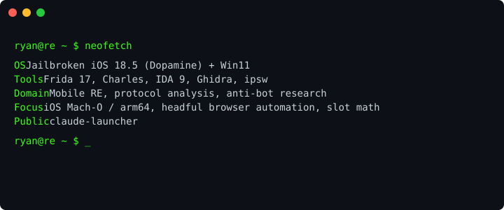
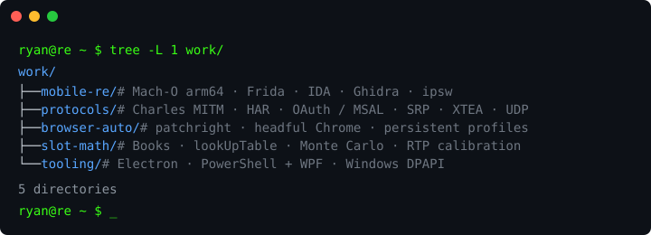

<samp><b>I reverse the stacks that hide. I build the tools that use the results.</b></samp>

<samp>public — <a href="https://github.com/squashyweeb/claude-launcher"><code>claude-launcher</code></a>&nbsp;&nbsp;·&nbsp;&nbsp;<a href="https://github.com/squashyweeb">github</a>&nbsp;·&nbsp;<a href="https://discordapp.com/users/783202111209996298">discord</a></samp>

